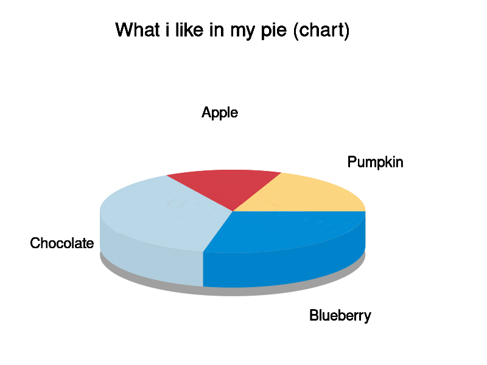

# pieplot

Small bash tool that outputs a gnuplot script to generate a pie plot.
It uses gnuplots `splot` function to draw cylinder sections in different colors
and adds a label next to each section.




```
USAGE: ./pieplot [OPTIONS] [DATAFILE]

  Creates a gnuplot script to generate a pie chart.
  Output can be piped directly into gnuplot.
  If no filename is given, data is read from stdin.

  Example:
    ./pieplot data.csv | gnuplot

  Data format:
  The first row is used as title for the pie chart
  Every other row is a data entry with the label in the first column
  and the value in the second column, separated by ;
  Line breaks in labels and title are possible with \n 

  Datafile Example:
  Disk Usage - Data2
  Used:\n 1031 GB;1031567272
  Free:\n 345 GB;345132256

  Options:
    -o, --output <filename>     [default: out.png]
        Sets the filename for the final image.
        The output of this program is still written to stdout.

    -s, --size <size>           [default: 800,600]
        Sets the image size in pixel.

    --fontsize <size>           [default: 18]
        Sets the font size for the slice labels

    --title-fontsize <size>     [default: 24]
        Sets the font size for the slice labels

```

Based on this work:
[Gnuplot tricks: Pie charts](http://www.phyast.pitt.edu/~zov1/gnuplot/html/pie.html)
They also have donuts if you are not into pie.
